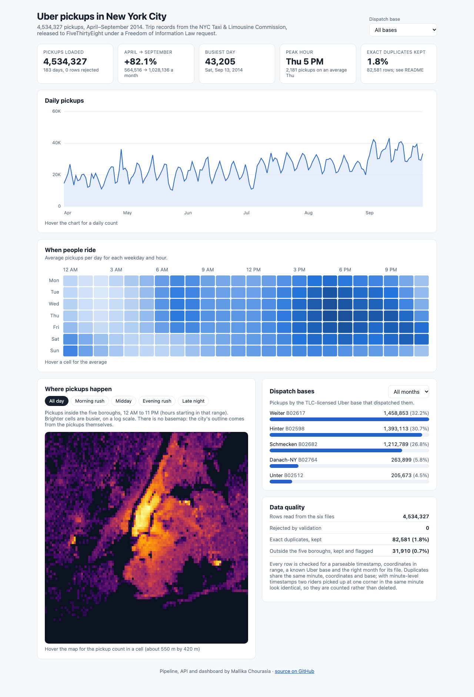

# Uber NYC Pickups: Data Pipeline & Metrics API

[](https://github.com/Mallika56/uber-nyc-pickups-pipeline/actions/workflows/ci.yml)

A PostgreSQL pipeline, FastAPI service and React dashboard over **4,534,327 real Uber pickups in
New York City, April–September 2014**: the trip records the NYC Taxi & Limousine Commission
released to FiveThirtyEight under a Freedom of Information Law request.



- **Pipeline** (Python, pandas, psycopg): downloads six monthly CSVs, validates every row against
  five rules, loads them into PostgreSQL in 100,000-row batches with `COPY` (one transaction per
  file, re-runnable), then rebuilds aggregate tables. The full load takes about a minute on a laptop.
- **API** (FastAPI): six endpoints serving demand by day, hour, weekday, dispatch base and map
  grid cell, with input validation on every query parameter.
- **Dashboard** (React + TypeScript): daily trend, weekday-by-hour heatmap, base split by month,
  and a pickup-density map. Charts are hand-drawn in SVG and canvas, with no charting library.
- **Tests**: 51 pytest tests (validation rules, loading against a real PostgreSQL database, and
  every API endpoint including bad input), run in GitHub Actions.

## Findings

All numbers come from the loaded data and can be reproduced through the API.

1. **Demand grew 82.1% in six months**, from 564,516 pickups in April to 1,028,136 in September.
   September alone accounts for 22.7% of the whole period.
2. **Weekday evenings are the peak.** The busiest slot is Thursday 5–6 PM, averaging 2,181
   pickups. Thursday is the busiest weekday (29,044 pickups on an average Thursday) and Sunday the
   quietest (18,853).
3. **Weekend nights behave like a different market.** Between midnight and 3 AM, Saturdays and
   Sundays (that is, Friday and Saturday nights) average 2,290 and 2,743 pickups, three to six
   times the 456–704 seen Monday to Thursday.
4. **Holidays empty the city.** The three quietest days are Memorial Day (Monday, May 26:
   10,202), the Sunday before it (10,841), and Saturday, July 5, the day after Independence Day
   (10,890). The busiest was Saturday, September 13 (43,205).
5. **Pickups are concentrated.** The busiest 1% of map cells (54 of 5,356 cells, each about
   550 m × 420 m) account for half of all pickups inside the five boroughs.
6. **Dispatch shifted between Uber's bases.** Danach-NY (B02764) went from 1.1% of pickups in
   July to 17.3% in September; Weiter (B02617) from 19.1% in April to 42.9% in August. The data
   records which licensed base dispatched a trip, not why, so this is an operational change
   inside Uber rather than a change in rider demand.

## Architecture

```
FiveThirtyEight CSVs (6 files, ~200 MB)
   │  pipeline/download.py   fetch missing files, check header, rename only when complete
   ▼
pipeline/validate.py        5 rules per row → clean rows | rejected rows with a reason
   │  pipeline/load.py       100K-row batches via COPY, one transaction per file,
   │                         skips files whose checksum hasn't changed
   ▼
PostgreSQL
   core.pickups             4.5M rows, indexed on time and (base, time)
   meta.load_log            per file: checksum, rows read / loaded / rejected
   meta.rejected_rows       file, line number, raw row, reason
   │  sql/marts.sql          rebuilt in a single transaction after each load
   ▼
   marts.daily_pickups · marts.weekday_hour · marts.weekday_days
   marts.pickup_grid · marts.quality_summary
   │
   ▼
FastAPI (api/main.py)  ──►  React + TypeScript dashboard (dashboard/), served by FastAPI
```

## Design decisions

- **Batched `COPY`, not row-by-row `INSERT`.** Each 100,000-row batch is validated in pandas and
  streamed to PostgreSQL with `COPY`, which avoids a round trip per row.
- **Re-runnable loads.** Each file's SHA-256 is stored in `meta.load_log`. Re-running skips
  unchanged files; a changed file (or `--force`) has its old rows deleted and reloaded in the same
  transaction, so a failed reload leaves the previous load intact instead of half-replaced.
- **Rejected rows are kept, not silently dropped.** Rows failing a rule (unparseable timestamp,
  missing or impossible coordinates, unknown base code, wrong month for the file) go to
  `meta.rejected_rows` with their line number and reason. The 2014 files are clean, so 0 rows
  were rejected; the rules are exercised by the test suite's fixture file instead.
- **Exact duplicates are counted, not deleted.** 82,581 rows (1.8%) share the same minute,
  coordinates and base as another row. Timestamps only have minute resolution and coordinates
  four decimal places (about 11 m), so two riders picked up at one corner in the same minute
  look identical. Deleting them would undercount busy places.
- **Pickups outside the boroughs are flagged.** 31,910 pickups (0.7%) are in New Jersey, Long
  Island and similar areas. A generated column, `in_nyc_bbox`, flags them; the map excludes them
  and every count includes them.
- **Indexes match the queries.** `(pickup_at)` serves time-range queries and
  `(base_code, pickup_at)` serves per-base ones. An hourly breakdown for one base on one day runs
  in about 1.7 ms as an index-only scan, against about 61 ms with indexes disabled (warm cache).
- **Averages divide by calendar days.** 183 days isn't a whole number of weeks: Tuesday appears
  27 times and every other weekday 26. The heatmap divides each weekday's total by how many of
  that weekday the data covers, so Tuesdays aren't inflated.
- **Timestamps stay in New York local time.** April to September 2014 falls entirely inside
  daylight saving time, so there are no repeated or skipped hours to handle.
- **No basemap.** The map is drawn from 0.005° grid cells on a log colour scale, with no
  third-party tiles or API keys. The shape of the city comes from the pickups themselves.

## API

Interactive docs are at `/docs` while the server runs.

| Endpoint | Returns | Parameters |
|---|---|---|
| `GET /health` | Service and database status | |
| `GET /api/summary` | Totals, busiest day, peak slot, monthly trend, base split, data quality | |
| `GET /api/daily` | Pickups per day | `start`, `end` (dates), `base` |
| `GET /api/hourly` | Average pickups per day for each weekday and hour | `base` |
| `GET /api/bases` | Pickups and share per dispatch base | `month` (4–9) |
| `GET /api/map` | Pickups per grid cell inside the five boroughs | `hour_from`, `hour_to` (0–23), `min_pickups` |

Invalid input returns `422` with a reason: an unknown base code, `start` after `end`, a month
outside the data, or `hour_from` after `hour_to`.

```bash
curl "http://localhost:8000/api/daily?start=2014-09-01&end=2014-09-03"
# [{"date":"2014-09-01","pickups":19961},{"date":"2014-09-02","pickups":28831},{"date":"2014-09-03","pickups":32631}]
```

## Run it locally

Needs Python 3.12+, PostgreSQL 16 and Node 20+.

```bash
python3 -m venv .venv && source .venv/bin/activate
pip install -r requirements.txt
createdb uber_nyc

python -m pipeline.run        # downloads ~200 MB, loads, builds marts (about a minute)

cd dashboard && npm install && npm run build && cd ..
uvicorn api.main:app          # dashboard at http://localhost:8000, API docs at /docs
```

`python -m pipeline.run --force` reloads every file; `--skip-download` uses what's already in
`data/raw/`. Settings are read from environment variables; see `.env.example`.

To work on the dashboard with hot reload, run `uvicorn api.main:app --reload` and, in
`dashboard/`, `npm run dev` (it proxies `/api` to port 8000).

The `Makefile` wraps these steps: `make setup`, `make db`, `make pipeline`, `make dashboard`,
`make serve`, `make test`.

**Docker:** `docker build -t uber-nyc .` builds the API and the dashboard into one image
(`docker run -p 8000:8000 -e DATABASE_URL=... uber-nyc`). The image only serves the API and
dashboard; it expects a PostgreSQL database already loaded by `python -m pipeline.run` to exist
at `DATABASE_URL`.

**macOS note:** if PostgreSQL won't start and its log says
`postmaster became multithreaded during startup`, set `LC_ALL=en_US.UTF-8` before starting it.

## Tests

```bash
createdb uber_nyc_test
pytest
```

The suite uses a 14-row fixture file, `tests/fixtures/uber-raw-data-apr14.csv`. Nine rows are
valid, including an exact duplicate pair and a Long Island pickup; five are invalid, one for each
validation rule. The tests cover:

- `test_validate.py`: each rule, rule order, line numbers, whitespace handling (no database)
- `test_load.py`: load counts, rejected-row reasons, skipping unchanged files, forced reloads that
  don't duplicate rows, batch-size independence, and the marts
- `test_api.py`: every endpoint, its filters, and its `422` responses

CI runs ruff and pytest against a PostgreSQL 16 service container, then type-checks and builds
the dashboard.

## Data

Source: [fivethirtyeight/uber-tlc-foil-response](https://github.com/fivethirtyeight/uber-tlc-foil-response),
`uber-trip-data/uber-raw-data-{apr..sep}14.csv`. Each row is one pickup: `Date/Time`, `Lat`, `Lon`,
and `Base`, the TLC licence code of the Uber base that dispatched it. Base names (Unter, Hinter,
Weiter, Schmecken, Danach-NY) come from that repository's README. The raw files aren't committed
here; the pipeline downloads them.

## Layout

```
pipeline/   config, download, validate, load, run (CLI), db helpers
sql/        schema.sql (tables, indexes), marts.sql (aggregates)
api/        FastAPI app and response models
dashboard/  React + TypeScript app (Vite)
tests/      pytest suite and fixture file
docs/       dashboard screenshot
Dockerfile  builds the API + dashboard into one image (see Run it locally)
```
